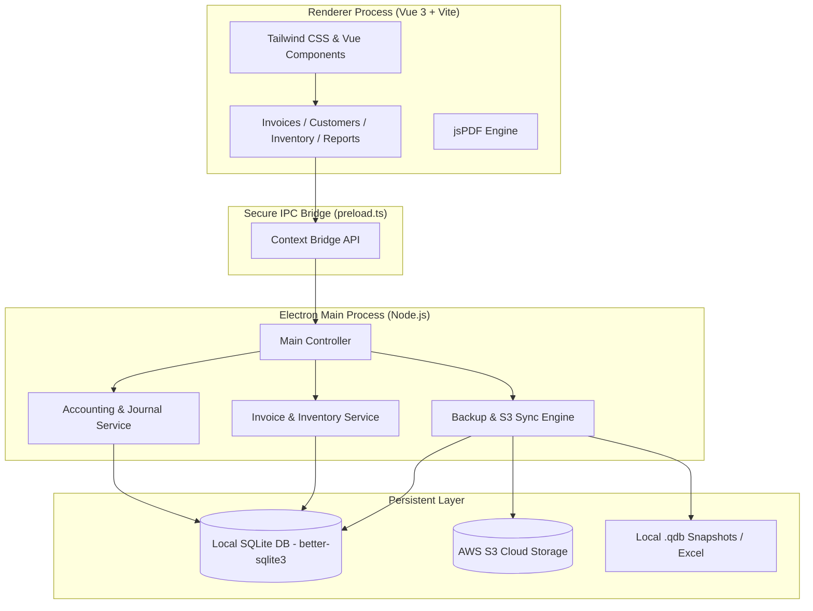

# Qalam (قلم) — Modern Offline-First Accounting & ERP

<p align="center">
  <strong>Fast, private, and resilient accounting software built for small and medium businesses in the UAE and Gulf region.</strong>
</p>

<p align="center">
  <a href="#features"></a>
  <a href="#tech-stack"></a>
  <a href="#tech-stack"></a>
  <a href="#tech-stack"></a>
  <a href="#license"></a>
</p>

---

## 💡 Why Qalam?

Most modern accounting platforms are strictly cloud-based SaaS solutions requiring ongoing subscriptions, persistent internet access, and third-party data hosting. 

**Qalam (قلم - "Pen")** takes a **hybrid, local-first approach**:
- ⚡ **Zero Latency:** Queries execute instantly on a local SQLite engine running in WAL (Write-Ahead Logging) mode.
- 🔒 **Absolute Data Privacy:** Your accounting data, customer balances, and tax records reside on your local machine — never hostage to recurring SaaS fees or cloud downtime.
- 🌐 **Offline-First Resilience:** Generate invoices, manage inventory, and log expenses even in warehouses, retail counters, or locations without internet.
- 🇦🇪 **UAE VAT & GCC Ready:** Out-of-the-box support for UAE 5% standard VAT, FTA-aligned tax calculations, and bilingual Arabic/English readiness.
- ☁️ **Hybrid Cloud Backup:** Optional one-click encrypted backups (`.qdb`) and Amazon S3 presigned cloud sync when you need cross-device redundancy.

---

## 📸 Application Preview

```
┌────────────────────────────────────────────────────────────────────────┐
│  Qalam Accounting ── Dashboard                             [User: Admin]│
├───────────────┬────────────────────────────────────────────────────────┤
│ 📊 Dashboard  │  Monthly Revenue     Outstanding Invoices   Total VAT  │
│ 🧾 Invoices   │  AED 142,500.00      AED 34,200.00          AED 7,125  │
│ 💰 Expenses   ├────────────────────────────────────────────────────────┤
│ 👥 Customers  │  Recent Invoices               Quick Actions           │
│ 📦 Inventory  │  INV-2026-001  Al-Noor LLC     [+ New Invoice]         │
│ 📈 Reports    │  INV-2026-002  Desert Star Tr. [+ Record Expense]      │
│ ⚙️ Settings   │  INV-2026-003  Oasis Tech FZE  [Export VAT Report]     │
└───────────────┴────────────────────────────────────────────────────────┘
```
*(Add actual screenshots of your Dashboard, Invoice Designer, and Reports to `docs/screenshots/`)*

---

## ✨ Key Features & Modules

### 1. 🧾 Invoicing & Billing
- **Compliant Invoices:** Generate professional tax invoices with subtotal, discount, VAT (5%), and net total calculations.
- **Line Item Management:** Autocomplete from inventory with quantity, unit prices, and customizable tax rates.
- **PDF Generation & Export:** Instant high-res invoice printing and vector PDF exports powered by `jspdf`.
- **Payment Status Tracking:** Real-time statuses (`Paid`, `Partial`, `Pending`, `Overdue`).

### 2. 👥 Customer & CRM Management
- Complete customer profiles with trade licenses, TRN (Tax Registration Number), and contact information.
- Live balance tracking and detailed historical ledger of all invoices and receipts.
- Credit term monitoring and aged receivable tracking.

### 3. 📦 Inventory & Stock Control
- Item catalog with SKU, cost price, selling price, and stock levels.
- Automated stock decrementing upon invoice issuance.
- Low-stock alerts and inventory valuation reporting.

### 4. 💸 Expense & Cash Management
- Categorized expense tracking (Rent, Utilities, Salaries, Transport, etc.).
- VAT input tax recording for tax offset reporting.
- Cash and bank account transaction reconciliations.

### 5. 📊 Financial Statements & Reports
- **Profit & Loss Statement (P&L):** Accurate gross and net income breakdown across custom date ranges.
- **Balance Sheet:** Real-time visibility into Assets, Liabilities, and Equity.
- **Trial Balance & General Ledger:** Complete double-entry verification with debit/credit balance consistency.
- **Cash Flow Statement:** Operating, investing, and financing cash flows.
- **FTA VAT 201 Report:** Ready-to-file summary of output tax collected vs. input tax paid.

### 6. 🛡️ Data Management & Cloud Sync
- **Local SQLite Engine:** High-performance local storage with automatic index optimization.
- **One-Click Backup & Restore:** Compressed `.qdb` snapshots with zip encryption.
- **S3 Cloud Sync Integration:** AWS S3 presigned URL support for automated off-site backups.
- **Data Portability:** Full Excel (`.xlsx`) and JSON export/import for accounting audit trails.

---

## 🏗️ System Architecture



---

## 🛠️ Tech Stack

| Layer | Technology | Description |
|---|---|---|
| **Shell** | [Electron 30](https://www.electronjs.org/) | Cross-platform desktop runtime |
| **Frontend Framework** | [Vue 3](https://vuejs.org/) (Composition API) | Reactive, component-driven user interface |
| **Build Tooling** | [Vite 5](https://vitejs.dev/) | Ultra-fast HMR and frontend bundling |
| **Language** | [TypeScript 5](https://www.typescriptlang.org/) | End-to-end type safety across Main & Renderer |
| **Styling** | [Tailwind CSS 3](https://tailwindcss.com/) | Modern utility-first responsive design |
| **Database** | [better-sqlite3](https://github.com/WiseLibs/better-sqlite3) | High-speed C++ synchronous SQLite bindings |
| **Documents / Exports** | [jsPDF](https://github.com/parallax/jsPDF) & [SheetJS (xlsx)](https://sheetjs.com/) | Client-side vector PDF and Excel generation |
| **Cloud Storage** | [@aws-sdk/client-s3](https://aws.amazon.com/sdk-for-javascript/) | Presigned URLs for off-site disaster recovery |

---

## 🚀 Quick Start for Developers

### Prerequisites
- [Node.js](https://nodejs.org/) (v18.x or v20.x recommended)
- [npm](https://www.npmjs.com/) or [yarn](https://yarnpkg.com/)
- C++ build tools (required for compiling native `better-sqlite3` bindings):
  - **Windows:** `npm install --global --production windows-build-tools` or install Visual Studio Build Tools with "Desktop development with C++".

### Installation & Setup

1. **Clone the repository:**
   ```bash
   git clone https://github.com/samah3303/qalam.git
   cd qalam/desktop
   ```

2. **Install dependencies:**
   ```bash
   npm install
   ```

3. **Start in Development Mode:**
   ```bash
   npm run dev
   ```
   *Launches Vite dev server with Electron hot-reloading.*

4. **Build Production Application:**
   ```bash
   # Type-check, compile Vue, and build Electron distribution
   npm run build
   ```

5. **Clean Distribution Build (Windows):**
   ```powershell
   ./clean-build.ps1
   ```
   Outputs unpacked binaries to `desktop/dist/win-unpacked/`.

---

## 📂 Project Structure

```
qalam/
├── desktop/                       # Electron desktop application
│   ├── electron/                  # Electron Main process
│   │   ├── database/              # SQLite connection & schema migrations
│   │   ├── services/              # Business logic (Invoicing, Accounting, Backup, etc.)
│   │   ├── preload.ts             # Context bridge IPC definitions
│   │   └── main.ts                # Application lifecycle & window management
│   ├── src/                       # Renderer process (Vue 3 frontend)
│   │   ├── components/            # UI components (Invoices, Customers, Reports, etc.)
│   │   ├── types/                 # TypeScript data contracts & database models
│   │   ├── utils/                 # PDF generators & formatting helpers
│   │   ├── App.vue                # Root application layout
│   │   └── main.ts                # Vue app initialization
│   ├── package.json               # Dependencies & build configuration
│   └── vite.config.ts             # Vite + Electron integration config
└── README.md                      # Repository documentation
```

---

## 🗺️ Roadmap

- [x] **v1.0.0 Core Release**
  - [x] Local SQLite engine with double-entry journal posting
  - [x] Invoicing, inventory deduction, and expense tracking
  - [x] Financial statements: P&L, Balance Sheet, VAT Report
  - [x] One-click `.qdb` compressed backup & restore
- [ ] **v1.1.0 Localization & Regional Standards**
  - [ ] Full Arabic language interface (RTL support)
  - [ ] FTA e-Invoice Phase 2 QR-code generation & XML formatting
- [ ] **v1.2.0 Multi-Platform & Collaboration**
  - [ ] macOS (.dmg) & Linux (.AppImage) distribution builds
  - [ ] Cross-device encrypted sync server
  - [ ] Role-based access control (Admin, Accountant, Sales)

---

## 🤝 Contributing

Contributions make the open-source community a fantastic place to learn, inspire, and create. Any contributions are **greatly appreciated**!

1. Fork the Project
2. Create your Feature Branch (`git checkout -b feature/AmazingFeature`)
3. Commit your Changes (`git commit -m 'feat: Add some AmazingFeature'`)
4. Push to the Branch (`git push origin feature/AmazingFeature`)
5. Open a Pull Request

---

## 📄 License

Distributed under the **MIT License**. See `LICENSE` for more information.

---

<p align="center">
  Crafted with care for businesses seeking speed, independence, and simplicity.
</p>
